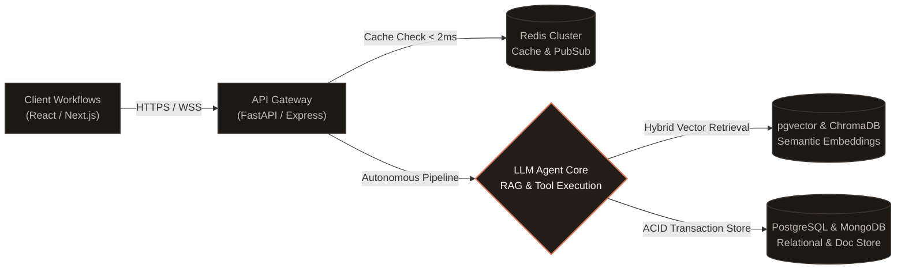

  

  
  
  
  

---

### 🕹️ The Interactive Arcade // Prompt Defender

> **Try to beat the high score:** Pilot the AI Agent shuttle, intercept failing HTTP 500 requests, catch memory leaks, and capture RAG & Redis tokens before production crashes.

  

  <a href="https://mayank190405.github.io/game/">
    <strong>▶ [CLICK HERE TO LAUNCH FULL PLAYABLE VERSION IN BROWSER]</strong>
  </a>
   
  Features synthesized 8-bit sound effects via Web Audio API, dynamic waves, and mobile touch support.

---

### 🏛️ Production Architecture & GenAI Blueprint

Here is how I design resilient, distributed systems—combining high-concurrency asynchronous backends with autonomous LLM reasoning loops:

  

---

### ⚡ Engineered Stack & Technical Matrix

A breakdown of technical proficiencies and system specializations:

  

---

### 📂 Featured Systems & Repositories

<table width="100%">
  <tr>
    <td width="50%" valign="top">
      <h4><a href="https://github.com/Mayank190405/bookmyveg-backend">📦 bookmyveg-backend</a></h4>
      
High-throughput backend engine for an on-demand agricultural supply-chain and grocery delivery platform.

      

        
        
        
        
      

      <ul>
        <li>Optimized asynchronous order queuing with transaction safety</li>
        <li>Dynamic geospatial store location matching algorithms</li>
      </ul>
    </td>
    <td width="50%" valign="top">
      <h4><a href="https://github.com/Mayank190405/jaydeveloperscrmbackend">🏢 jaydeveloperscrmbackend</a></h4>
      
Microservices infrastructure powering CRM workflows for real-estate developer teams and high-ticket customer lifecycles.

      

        
        
        
        
      

      <ul>
        <li>Granular Role-Based Access Control (RBAC) & audit logging</li>
        <li>Automated webhook triggers for agent follow-ups and lead scoring</li>
      </ul>
    </td>
  </tr>
  <tr>
    <td width="50%" valign="top">
      <h4><a href="https://github.com/Mayank190405/jd-crm">⚙️ jd-crm</a></h4>
      
Core workflow automation engine tailored for enterprise CRM pipeline tracking and lead qualification.

      

        
        
        
      

      <ul>
        <li>Complex stage migration rules with zero data inconsistency</li>
        <li>Custom business analytics aggregation pipelines</li>
      </ul>
    </td>
    <td width="50%" valign="top">
      <h4><a href="https://github.com/Mayank190405/jd_frontend">💻 jd_frontend</a></h4>
      
Responsive, real-time administrative interface and CRM control room.

      

        
        
        
      

      <ul>
        <li>Real-time dashboard telemetry and interactive Kanban pipelines</li>
        <li>Optimized component rendering with virtualized tables</li>
      </ul>
    </td>
  </tr>
</table>

---

### 📬 Dispatch & Collaboration

  

