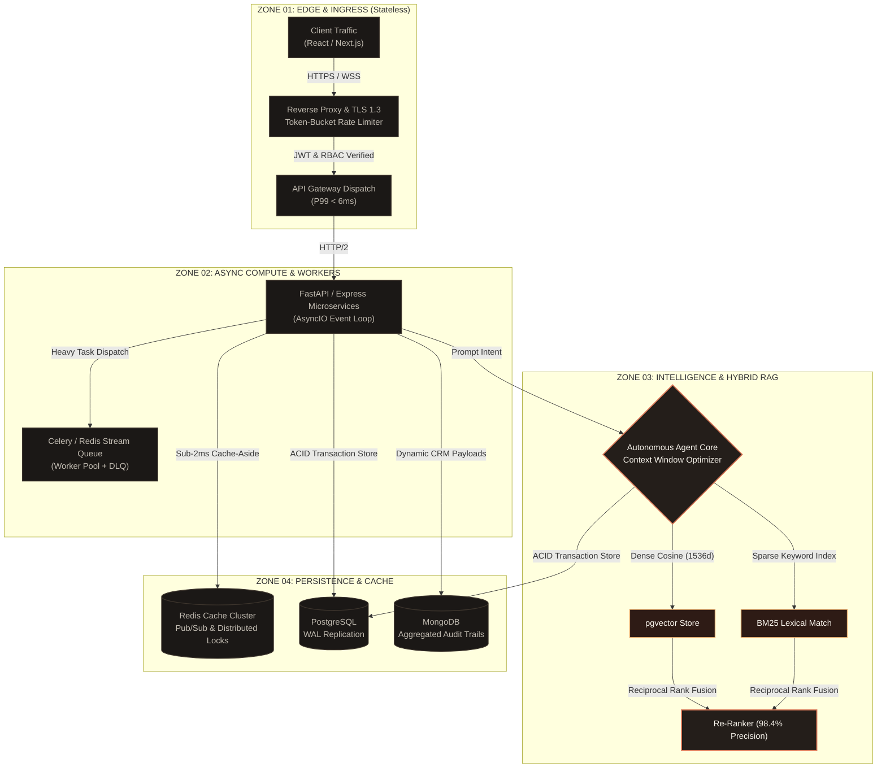
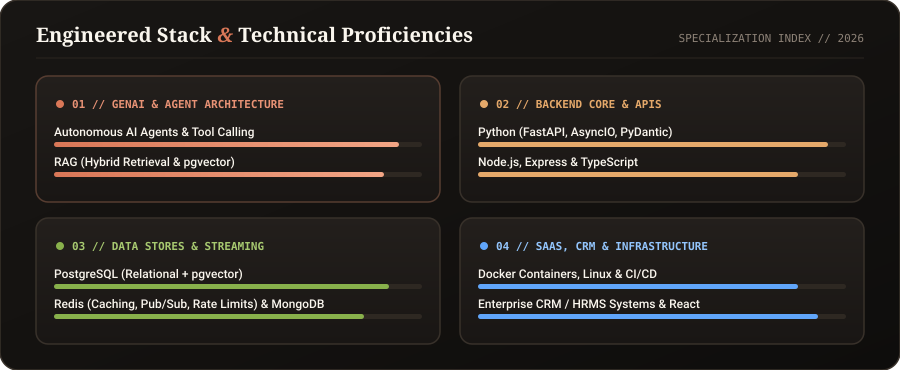
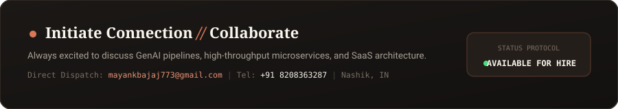

<p align="center">
  
</p>

<p align="center">
  <a href="https://mayank190405.github.io/visualizer/"></a>
  <a href="mailto:mayankbajaj773@gmail.com"></a>
  <a href="https://github.com/Mayank190405"></a>
  
</p>

---

### ⚡ Interactive Algorithm Engine // Selection Sort Trace

> **Array Selection Invariant:** For each pass `i` from `0` to `n-1`, find the minimum element in unsorted sub-array `A[i..n-1]` and swap it into its final sorted position `A[i]`.

<p align="center">
  <a href="https://mayank190405.github.io/visualizer/">
    
  </a>
</p>

<p align="center">
  <a href="https://mayank190405.github.io/visualizer/">
    <strong>▶ [LAUNCH INTERACTIVE VISUALIZER: INPUT YOUR OWN NUMBERS & SORT]</strong>
  </a>
  <br>
  <sub>Features custom array entry, step-by-step pointers, Web Audio frequency synthesis, and live metric tracking.</sub>
</p>

```python
def selection_sort(arr: list[int]) -> list[int]:
    """Selects and sorts minimum elements in-place: O(n²) time, O(1) space."""
    n = len(arr)
    for i in range(n - 1):
        min_idx = i
        for j in range(i + 1, n):
            if arr[j] < arr[min_idx]:
                min_idx = j
        if min_idx != i:
            arr[i], arr[min_idx] = arr[min_idx], arr[i]
    return arr
```

---

### 🏛️ Production Architecture & System Topology

Every system I build is planned around four fault-isolated tiers: **Edge Ingress**, **Asynchronous Compute**, **Reasoning & RAG Retrieval**, and **Stateful Persistence**.

<p align="center">
  
</p>

#### Planned Architectural Decisions & Trade-Offs



#### 📐 Core Engineering Principles

* **1. Asynchronous Task Decoupling**: CPU-heavy LLM token processing and context embedding generation are isolated behind Redis stream worker queues with Dead Letter Queues (DLQ), ensuring public HTTP REST endpoints maintain a sub-20ms responsiveness under load.
* **2. Hybrid RAG (Dense + Sparse)**: Relying solely on vector embeddings leads to semantic hallucinations for domain-specific CRM keywords and IDs. The pipeline combines dense cosine similarity (pgvector) with sparse lexical search (BM25) fused via Reciprocal Rank Fusion (RRF).
* **3. Layered Cache-Aside**: Redis sits immediately upstream of PostgreSQL, handling session tokens, rate counters, and high-frequency queries to absorb over 80% of database read pressure.
* **4. Circuit Breakers & Graceful Degradation**: External AI API dependencies use automated circuit breakers with exponential backoff and localized fallback heuristics to prevent service-wide cascading failures.

---

### ⚡ Engineered Stack & Technical Matrix

A breakdown of technical proficiencies and system specializations:

<p align="center">
  
</p>

---

### 📂 Featured Systems & Repositories

<table width="100%">
  <tr>
    <td width="50%" valign="top">
      <h4><a href="https://github.com/Mayank190405/bookmyveg-backend">📦 bookmyveg-backend</a></h4>
      <p>High-throughput backend engine for an on-demand agricultural supply-chain and grocery delivery platform.</p>
      <p>
        
        
        
        
      </p>
      <ul>
        <li>Optimized asynchronous order queuing with transaction safety</li>
        <li>Dynamic geospatial store location matching algorithms</li>
      </ul>
    </td>
    <td width="50%" valign="top">
      <h4><a href="https://github.com/Mayank190405/jaydeveloperscrmbackend">🏢 jaydeveloperscrmbackend</a></h4>
      <p>Microservices infrastructure powering CRM workflows for real-estate developer teams and high-ticket customer lifecycles.</p>
      <p>
        
        
        
        
      </p>
      <ul>
        <li>Granular Role-Based Access Control (RBAC) & audit logging</li>
        <li>Automated webhook triggers for agent follow-ups and lead scoring</li>
      </ul>
    </td>
  </tr>
  <tr>
    <td width="50%" valign="top">
      <h4><a href="https://github.com/Mayank190405/jd-crm">⚙️ jd-crm</a></h4>
      <p>Core workflow automation engine tailored for enterprise CRM pipeline tracking and lead qualification.</p>
      <p>
        
        
        
      </p>
      <ul>
        <li>Complex stage migration rules with zero data inconsistency</li>
        <li>Custom business analytics aggregation pipelines</li>
      </ul>
    </td>
    <td width="50%" valign="top">
      <h4><a href="https://github.com/Mayank190405/jd_frontend">💻 jd_frontend</a></h4>
      <p>Responsive, real-time administrative interface and CRM control room.</p>
      <p>
        
        
        
      </p>
      <ul>
        <li>Real-time dashboard telemetry and interactive Kanban pipelines</li>
        <li>Optimized component rendering with virtualized tables</li>
      </ul>
    </td>
  </tr>
</table>

---

### 📬 Dispatch & Collaboration

<p align="center">
  <a href="mailto:mayankbajaj773@gmail.com">
    
  </a>
</p>
